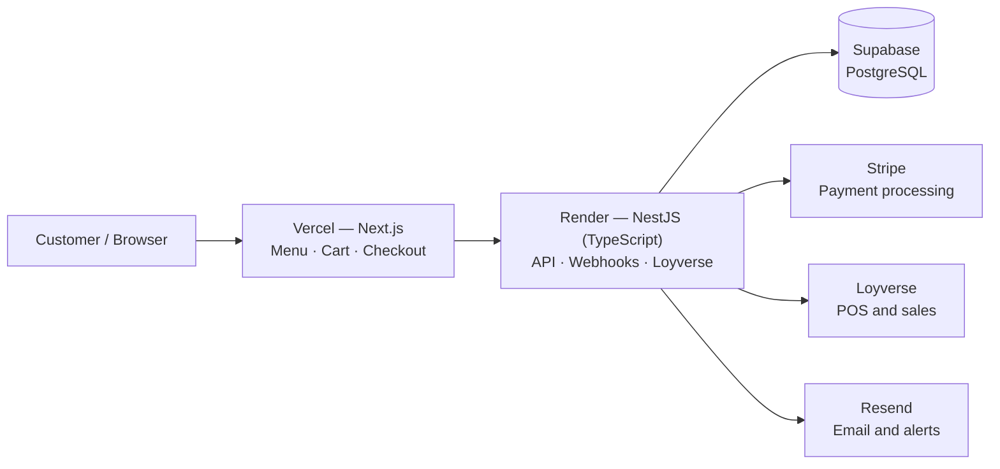

# restaurant-platform

Online-ordering platform for a restaurant. **Monorepo scaffold — no business logic yet.**

## Architecture (plan.md §1)



Request flow: `Customer → Vercel (Next.js) → Render (NestJS, Express by default) → Supabase Postgres`, with the API talking to Stripe (payments + webhooks), Loyverse (POS/KDS) and Resend (order emails).

> NestJS runs on its default **Express** platform; the Fastify adapter is out of scope (plan.md §2.B). Stripe webhooks need the **raw request body** for signature verification, so `main.ts` enables `rawBody` — but webhook verification logic is deliberately not part of this scaffold.

## Repository layout

```
apps/api/          NestJS API (owner: dev) — orders, payments, menu, loyverse, notifications
apps/web/          Next.js storefront (owner: frontend) — not created in this scaffold
packages/shared/   Zod schemas, shared types, money helpers, order state machine (owner: dev)
supabase/          Migrations & local DB (owner: dba) — not created in this scaffold
docs/adr/          Architecture Decision Records
```

npm workspaces: `["apps/*", "packages/*"]`. Node **>= 20** (see `.nvmrc`).

## Getting started

```bash
nvm use            # Node 20
npm ci             # install all workspaces from the lockfile
npm run build      # build packages/shared, then apps/api
npm run typecheck  # tsc --noEmit for both workspaces
npm run lint       # eslint (flat config at repo root)
npm run format     # prettier --write .
```

## Environment

Copy `.env.example` → `.env` (root) and `apps/api/.env.example` → `apps/api/.env`. **Never commit real values.** Secrets are read from the environment only and validated at boot by the config module. `PAYMENT_MODE=mock` is for the POC only and must not be used in production (plan.md §9.5).

## Deploy / CI

- `.github/workflows/ci.yml` — `npm ci`, build, lint, typecheck, format check.
- `render.yaml` — Render Blueprint for the NestJS API (build/start). Secrets are **not** in this file; set them in the Render dashboard. This is a placeholder to be reviewed by `code-review` before any deploy.
- `vercel.json` is an intentional root placeholder. The real Vercel configuration is owned by **`apps/web`** (frontend); point the Vercel project's Root Directory at `apps/web`.

## Invariants (enforced in code once features are built)

- Money is integer centavos; the server owns prices.
- Stripe webhooks are the source of truth for payment (raw body + idempotent by event ID).
- A paid order is never lost to a Loyverse/Resend failure.
- No secrets or PII in code or logs; untrusted customer text is escaped and length-bounded.

This scaffold contains **no business logic, no Stripe/Loyverse keys, and no DB migrations**.

## POC (plan.md §9) — Loyverse + kitchen screen

Harness built and security-cleared (code-review CLEAR, 0 High). **Gate CLOSED**: web-order delivery to Loyverse KDS is **unvalidated** until human test H2 is recorded with real-device evidence.

- Decision + H1–H8 status: `docs/adr/0001-loyverse-poc-and-kitchen-screen.md` (H1–H5/H7 PENDING human real-device test; H6/H8 logic covered by automated tests, human confirmation pending).
- Env reference (names only): `docs/POC_ENV.md`. Human test hooks: `docs/POC_TEST_HOOKS.md`. Local run + tablet steps + failure table: `docs/POC_RUNBOOK.md`. Schema runbook: `supabase/POC_SCHEMA_NOTES.md`.
- Quick local run: `supabase start && supabase db reset && supabase db lint`, regenerate types (`supabase gen types typescript --local > packages/shared/src/db/database.types.ts`), then `npm ci && npm run build && npm run typecheck && npm test` (133 tests per dev handoff). **Test Loyverse account only** — replace the placeholder variant UUIDs in `supabase/seed.sql` before H1; void test receipts after the run.

Known limitations: KDS premise unvalidated (H2); POS orders expected visible only at charge (H4); free-plan sales-history cap; single-instance scheduler; static menu pricelist; no `POST /orders` idempotency. Full list in the ADR.
